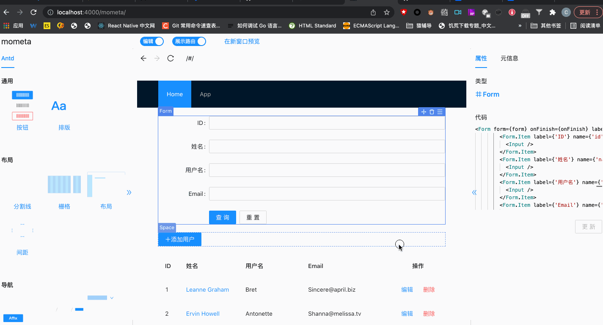
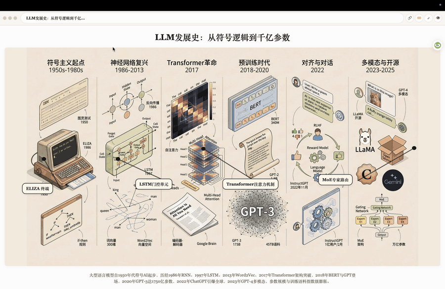

**🐟 Cong Yu · 前端 / 全栈 / AI 工具**

[Blog](https://imcuttle.github.io) · [GitHub](https://github.com/imcuttle)

**✨ 代表作**

**[mometa](https://github.com/imcuttle/mometa) · ⭐ 4.1k** — 面向研发的低代码元编程：在运行中的页面上可视化编辑源码，辅助编码。TypeScript。

 

**[flipbook-app](https://github.com/imcuttle/flipbook-app) · ⭐ 406** — 点击式探索的知识画册：长按图片生成带标注的子图，LLM + 图像生成 + 联网搜索 + OCR 可插拔流水线。React / Vite / Express。

 

**🎮 游戏与创意**

- [star-island](https://github.com/imcuttle/star-island) · [在线体验](https://star-island.pages.dev) — 5–10 岁寓教于乐的网页学习游戏，10 个学科区域、435 关、54 种玩法，含 3D 与物理小游戏。
- [lottery-spin](https://github.com/imcuttle/lottery-spin) — 目录文件老虎机抽奖 CLI：澳门风格 Three.js 3D 老虎机，中奖一键打开。

**🤖 AI 与效率工具**

- [proxybaby](https://github.com/imcuttle/proxybaby) — 免费开源全平台抓包工具，内置 AI / SSE 美化（OpenAI / Anthropic / ACP），兼容 whistle 规则，带 CLI 与 Agent Skill。Electron + TypeScript。
- [wechat-relay](https://github.com/imcuttle/wechat-relay) — 后台识别电脑版微信聊天，用自定义模型 / harness 自动回复（Cua Driver + Vision OCR）。TypeScript。
- [cleanyourtv](https://github.com/imcuttle/cleanyourtv) — Fork：Wi-Fi 精简安卓 / Google TV，换 Apple TV 风格桌面。

**🧰 早期开源库**

| 项目 | 说明 | ⭐ |
|---|---|---|
| [measure](https://github.com/imcuttle/measure) | PSD 标注测量 UI | 138 |
| [remark-heading-id](https://github.com/imcuttle/remark-heading-id) | remark 自定义标题 id 插件 | 45 |
| [moUploader](https://github.com/imcuttle/moUploader) | 移动端上传插件 | 30 |
| [request-song-robot](https://github.com/imcuttle/request-song-robot) | 网易云点歌机器人 | 27 |
| [paint_online](https://github.com/imcuttle/paint_online) / [paint_game](https://github.com/imcuttle/paint_game) | socket.io 实时画板 / 你画我猜 | 26 / 21 |
| [simple-hot-reload-server](https://github.com/imcuttle/simple-hot-reload-server) | 简易热重载服务 | 23 |
| [node-await-event-emitter](https://github.com/imcuttle/node-await-event-emitter) | 支持 await 的 EventEmitter | 21 |
| [mometa-mat](https://github.com/imcuttle/mometa-mat) | mometa 物料库 | 20 |

更多仓库见 [GitHub 主页](https://github.com/imcuttle?tab=repositories)。
