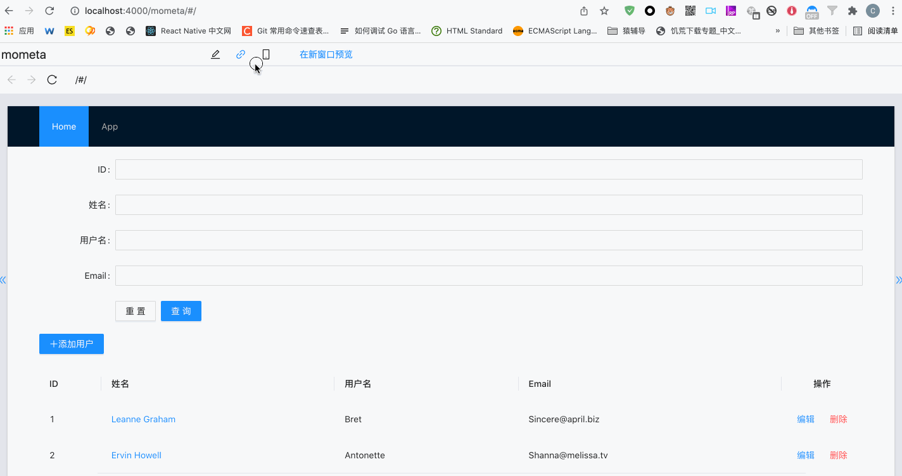
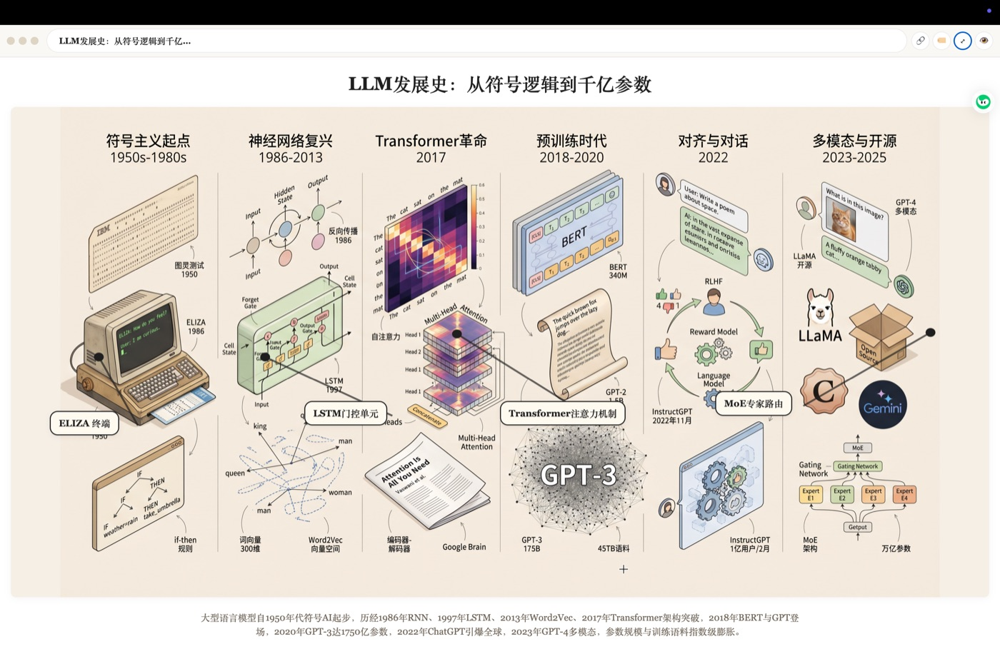
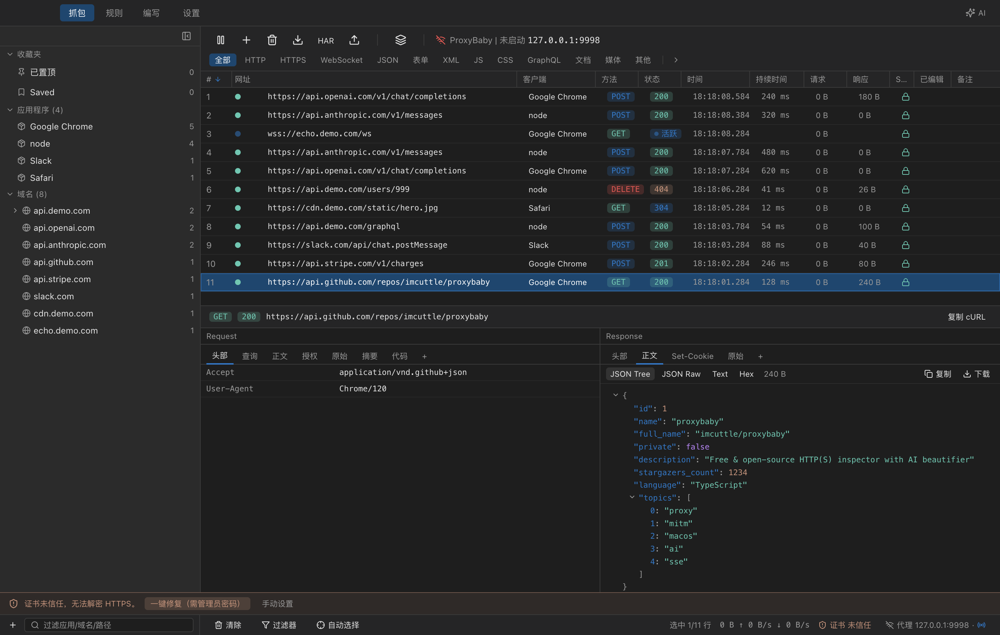
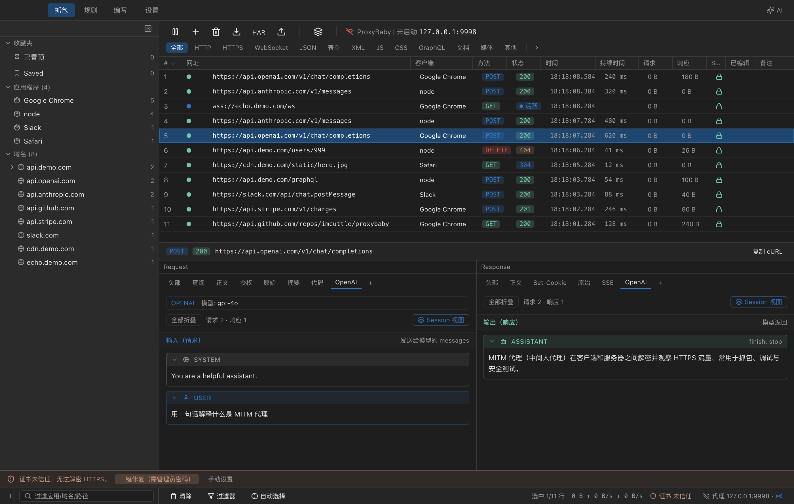
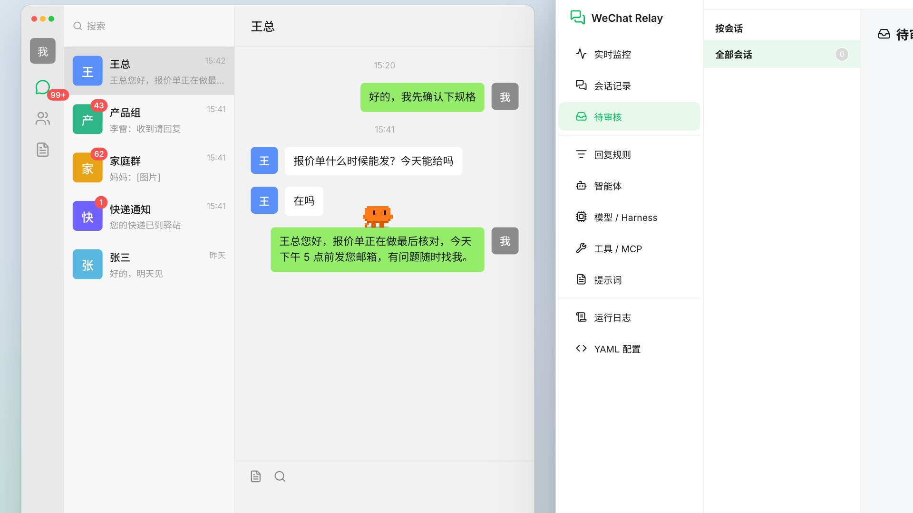
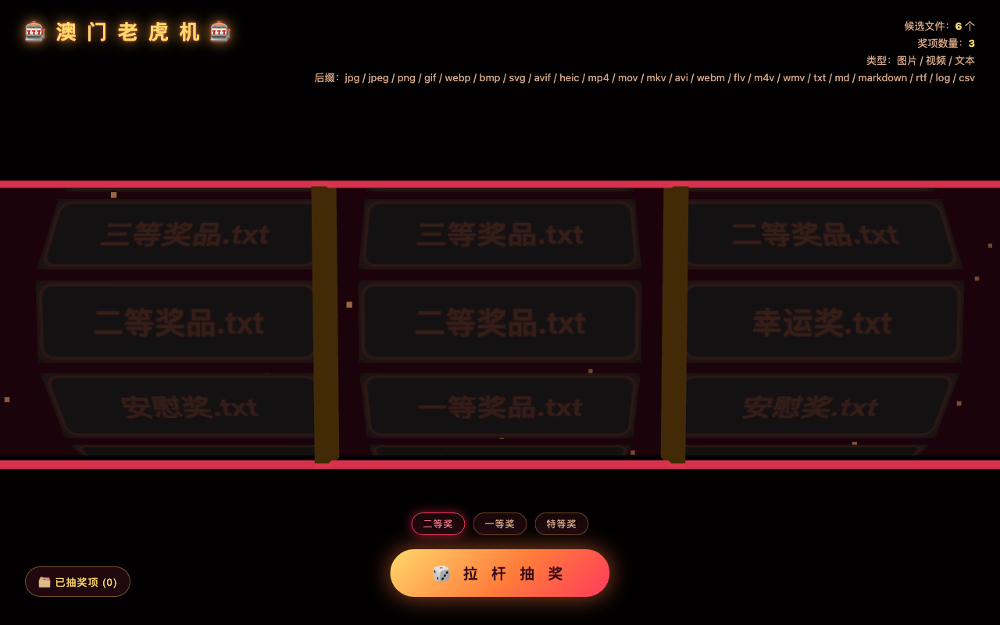
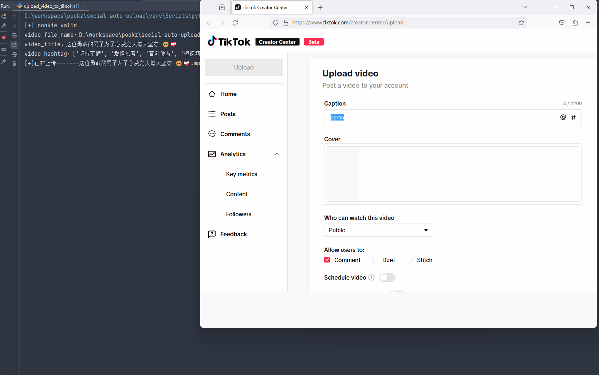

# Cong Yu · Portfolio

🐟 Coddddder · 前端 / 全栈 / AI 工具 · [Blog](https://imcuttle.github.io) · [GitHub](https://github.com/imcuttle)

> 🔒 标记为私有仓库，链接仅本人登录后可访问。

## ✨ 代表作

### [mometa](https://github.com/imcuttle/mometa) · ⭐ 4.1k
面向研发的低代码元编程：在运行中的页面上可视化编辑源码，辅助编码。TypeScript。

 

### [flipbook-app](https://github.com/imcuttle/flipbook-app) · ⭐ 406
点击式探索的知识画册：长按图片即可生成带标注的子图，LLM + 图像生成 + 联网搜索 + OCR 可插拔流水线。React / Vite / Express。

 

### [proxybaby](https://github.com/imcuttle/proxybaby) · ⭐ 2
免费开源的全平台抓包工具：内置 AI / SSE 美化（OpenAI / Anthropic / ACP）、兼容 whistle 规则、带 CLI 与 Agent Skill。Electron + TypeScript。

 

### [wechat-relay](https://github.com/imcuttle/wechat-relay) · ⭐ 2
后台识别电脑版微信聊天，用自定义模型 / harness 自动回复（Cua Driver + Vision OCR）。TypeScript。

## 🎮 游戏与创意

### [star-island](https://github.com/imcuttle/star-island) · [在线体验](https://star-island.pages.dev)
星星岛大冒险：5–10 岁寓教于乐的静态网页学习游戏，10 个学科区域、435 关、54 种玩法，3D 与物理小游戏。

### [hypeverse](https://github.com/imcuttle/hypeverse) 🔒
嗨动宇宙 HYPEVERSE：纯静态多人体感派对游戏合集，摄像头肢体识别 + 麦克风声控，45 款游戏，支持手机投屏 / 大屏直连。

### [shadow-ranger](https://github.com/imcuttle/shadow-ranger) 🔒
影·游侠：用真实阴影作为地图的动作游戏。

### [lottery-spin](https://github.com/imcuttle/lottery-spin)
目录文件老虎机抽奖 CLI：澳门风格 Three.js 3D 老虎机，扫描目录文件作为奖品，中奖一键打开。

## 🤖 AI 与效率工具

| 项目 | 说明 | 图 |
|---|---|---|
| [the-black](https://github.com/imcuttle/the-black) 🔒 | 小黑 The Black，个人 AI 助手（App + Admin + Server） |  |
| [subbuddy](https://github.com/imcuttle/subbuddy) 🔒 | 视频字幕生成 + 实时半透明翻译浮层（Electron） |  |
| [fake-guy](https://github.com/imcuttle/fake-guy) 🔒 | PWA 小应用 |  |
| [social-auto-upload](https://github.com/imcuttle/social-auto-upload) 🔒 | 自动上传视频到抖音、小红书、视频号、TikTok、YouTube、B 站 |  |
| [cleanyourtv](https://github.com/imcuttle/cleanyourtv) | Fork：Wi-Fi 精简安卓 / Google TV，换 Apple TV 风格桌面 | |

## 🧰 前端工程与开源库（早期）

| 项目 | 说明 | ⭐ |
|---|---|---|
| [edam](https://github.com/imcuttle/edam) | 多功能脚手架生成器 | 10 |
| [measure](https://github.com/imcuttle/measure) | PSD 标注测量 UI | 138 |
| [remark-heading-id](https://github.com/imcuttle/remark-heading-id) | remark 自定义标题 id 插件 | 45 |
| [request-song-robot](https://github.com/imcuttle/request-song-robot) | 网易云点歌机器人 | 27 |
| [moUploader](https://github.com/imcuttle/moUploader) | 移动端上传插件 | 30 |
| [paint_online](https://github.com/imcuttle/paint_online) / [paint_game](https://github.com/imcuttle/paint_game) | socket.io 实时画板 / 你画我猜 | 26 / 21 |
| [simple-hot-reload-server](https://github.com/imcuttle/simple-hot-reload-server) | 简易热重载服务 | 23 |
| [node-await-event-emitter](https://github.com/imcuttle/node-await-event-emitter) | 支持 await 的 EventEmitter | 21 |
| [mometa-mat](https://github.com/imcuttle/mometa-mat) | mometa 物料库 | 20 |
| [babel-plugin-danger-remove-unused-import](https://github.com/imcuttle/babel-plugin-danger-remove-unused-import) | 移除未使用 import | 19 |
| [hot-module-require](https://github.com/imcuttle/hot-module-require) | 类 HMR 的热 require | 12 |
| [live-markd](https://github.com/imcuttle/live-markd) | 实时渲染的 GitHub 风格 Markdown 预览 | 9 |
| [tiny-i18n](https://github.com/imcuttle/tiny-i18n) | 轻量国际化库 | 8 |
| [rcp](https://github.com/imcuttle/rcp) | React 组件工具集 | 6 |
| [walli](https://github.com/imcuttle/walli) | 可管理的校验库 | 4 |

更多仓库见 [GitHub 主页](https://github.com/imcuttle?tab=repositories)。